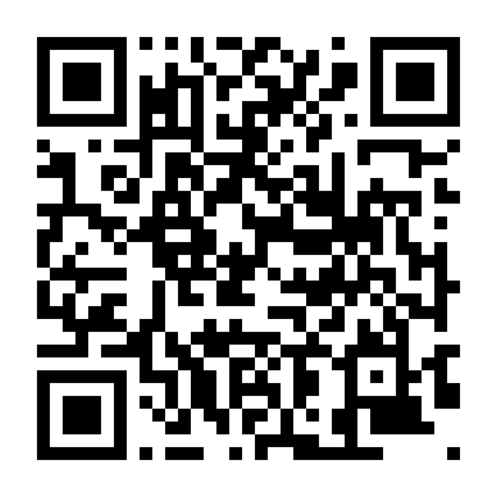

# CKA Under Pressure: A Better Way to Practice

**Chad Crowell** · KubeCon NA 2026 tip talk

> **Don't practice until the exercise feels familiar. Practice until you can solve it without the walkthrough.**

## The loop: Read → Orient → Solve → Verify → Review

| Step | Do this |
|---|---|
| **Read** | Say the requested outcome in one sentence. List the constraints: names, ports, counts, what *must not change*. |
| **Orient** | Confirm the context and namespace. Inspect what exists *before* you change anything. |
| **Solve** | Make the smallest justified change. One change, then look. |
| **Verify** | Test **each** acceptance criterion by its behavior, from where the client lives. |
| **Review** | Name where you hesitated and why. Choose the one skill to drill next. |

## Preflight checklist (before the first change)

- [ ] Right cluster and context? (`kubectl config current-context`)
- [ ] Right namespace on every command? (`-n`, or checked)
- [ ] Criteria read twice, constraints underlined?
- [ ] Current state inspected (`get`, `describe`, events)?
- [ ] I know what "done" looks like, and how I will test it?
- [ ] Mode chosen: learning, independent, or timed?

## Remember

- **A successful command is not proof of a completed task.** `service/web exposed` tells you
  the API accepted the object, not that traffic reaches your app.
- **Learn first, then add time pressure.** The timer is a diagnostic tool for finding gaps,
  not the goal of every session. Fast typing is not competence.
- **Hints are data.** Log which one you needed; it shows you the gap.

## The ladder

1. Learn the skill with no timer → 2. Attempt it on your own → 3. Verify against the
criteria → 4. Review mistakes and hesitation → 5. Repeat with a **variation** →
6. Add the timer once the workflow is solid.

## My next practice action

Drill / variation: ______________________________________________

When: ________________   Mode: ☐ learning  ☐ independent  ☐ timed

## Get the kit

`https://github.com/kubeskills/cka-under-pressure`

---

*Original practice material. Not the exam, not affiliated with the exam, and it does not
reproduce the exam environment. Lab checks are not official scoring, and completing the
exercises does not guarantee a pass. For exam rules and requirements, use the official
Linux Foundation / CNCF pages.*
